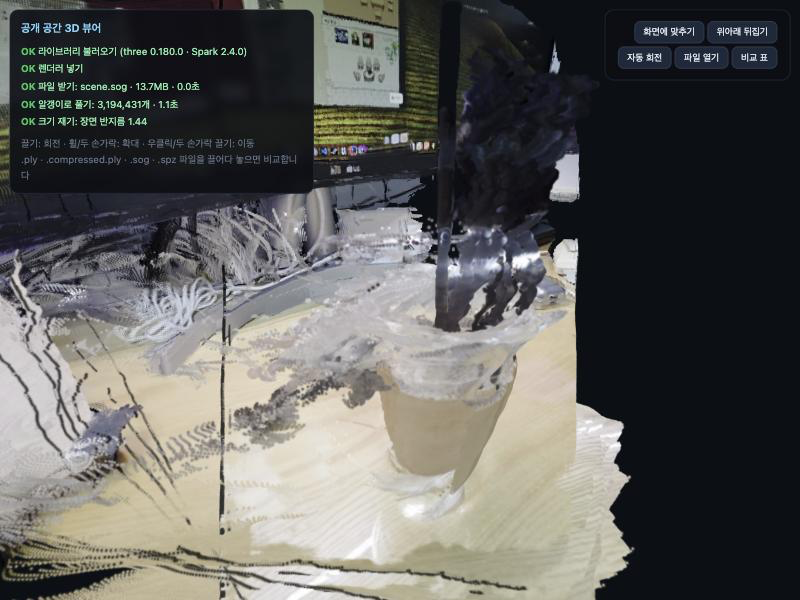

# 공개 가능한 공간의 3D 뷰어 — 책상 위 아이스 커피 컵

**보기** https://woochoi.github.io/three-dimension/4_homework/
**장면 파일** https://woochoi.github.io/three-dimension/4_homework/scene.sog



직접 찍은 영상 `cup.mp4`(6초) 하나에서 맥북(Apple M5 Pro)의 GPU로 점을 얻고, 반투명 알갱이(가우시안 스플랫)로 바꿔 웹에 올렸습니다. 데모 파일이 아니라 내 영상을 복원한 결과입니다.

## 1. 공개 판단 (25점)

- 고른 공간: 내 책상 위 테이크아웃 아이스 커피 컵과 그 주변 (책상 면, 케이블, 모니터 하단)
- 공개해도 되는 이유 (한 줄): 촬영 허락이 필요 없는 내 책상이고, 사람 얼굴·문패·차량 번호가 없으며, 뒤 모니터 화면은 모델 입력 해상도(294×518)로 줄어 3D 장면에서 글자를 알아볼 수 없다. 원본 영상과 프레임은 저장소에 올리지 않았다.

## 2. 촬영

| 항목 | 값 |
|---|---|
| 촬영한 부분 | 컵 정면~오른쪽 옆면, 컵 뒤 책상 면과 케이블, 모니터 하단 |
| 걸은 경로 | 컵 정면에서 오른쪽으로 옆걸음하며 컵을 바라보는 짧은 원호 (약 60°) |
| 영상 길이 · 해상도 | 6.0초 · 1080×1920 (30fps, 180프레임) |
| 방향 | 세로 (권장은 가로) |
| 추출한 프레임 수 | 24 |

## 3. 복원 결과 (수치 판정 25점)

| 항목 | 값 |
|---|---|
| 장치 / 복원 시간 / GPU 메모리 | MacBook Apple M5 Pro (MPS, fp16) / 6.7초 (모델 준비 15.8초 별도) / 8.76GB (MPS 드라이버 할당) |
| 점 개수 | 3,285,020 → 축별 0.5% 튄 점 제거 후 3,194,431 |
| 카메라 퍼짐 비 (카메라 상자 대각선 ÷ 장면 상자 대각선) | 1.067 ÷ 2.869 = **0.372** (기준 0.1 초과) |
| 실제 촬영 경로와 비교 | 위에서 본 카메라 배치가 정면에서 오른쪽으로 휘는 원호로 나타나 실제로 걸은 경로와 맞음. 카메라는 모두 컵 쪽을 향함. 손떨림 때문에 경로가 약간 지그재그 |
| 알갱이 반지름 (K=1.4) | 0.00155 (장면 긴 변 1.983 ÷ √3,194,431 × 1.4) |

## 4. 형식별 비교

도구: `npx -y @playcanvas/splat-transform@3.10.3 -w`. 크기는 바이트, MB = 1,000,000 바이트 기준.

| 형식 | 파일 크기 (바이트) | MB | 변환 시간 | 알갱이 수 | 알갱이당 바이트 | PLY 대비 |
|---|---:|---:|---:|---:|---:|---:|
| `.ply (원본)` | 217,221,725 | 217.22 | – | 3,194,431 | 68.0 | 1.0배 |
| `.compressed.ply` | 52,010,046 | 52.01 | 2.7초 | 3,194,431 | 16.28 | 4.2배 |
| `.sog` | 13,712,277 | 13.71 | 2.7초 | 3,194,431 | 4.29 | 15.8배 |
| `.spz` | 16,211,912 | 16.21 | 2.9초 | 3,194,431 | 5.08 | 13.4배 |

- Pages에 올린 형식: `.sog` — 고른 이유: 네 형식 중 가장 작고(13.7MB, PLY의 1/15.8) 알갱이 수는 같으며, 뷰어에서 같은 시점으로 비교했을 때 컵·빨대·케이블 모양에 눈에 띄는 차이가 없었다. 원본 PLY(217MB)는 GitHub 100MiB 제한을 넘어 올릴 수 없다.
- 세 형식의 알갱이 수가 같은가: 같음 (각 결과를 다시 PLY로 풀어 헤더의 개수를 확인, 뷰어에서도 3,194,431개)

## 5. 주소 동작 (25점)

| 기기 | 통신 | 첫 화면까지 | 비고 |
|---|---|---:|---|
| 내 폰 (갤럭시 S25, Chrome 첫 방문) | Wi-Fi (기가 인터넷, 공유기 근처) | 파일 받기 0.7초 + 알갱이로 풀기 0.4초 | scene.sog 13.7MB, 알갱이 3,194,431개. 약 157Mbps로 받음 |
| 내 폰 (갤럭시 S25, 이전에 연 적 있는 브라우저) | Wi-Fi (기가 인터넷, 공유기 근처) | 파일 받기 0.1초 | 첫 방문의 1/7 수준이라 브라우저 캐시에서 다시 읽은 값으로 판단 |
| 다른 사람 폰 ( 기종 ) | ( ) | ( 초) | 첫 방문 |

## 6. 한계 설명 (25점)

- 잘 보이는 방향: 처음 열리는 시점(첫 촬영 위치)과 그 오른쪽 원호 구간. 컵의 종이 슬리브, 책상 나뭇결, 케이블이 알아볼 수 있게 나온다.
- 구멍·검은 얼룩·잡티가 드러나는 방향: ① 왼쪽 옆이나 컵 뒤로 돌아가면 장면이 얇은 판처럼 무너지고 뒤가 검게 비어 보인다. ② 투명 뚜껑과 컵 윗부분이 하얗게 번진다. ③ 빨대와 케이블처럼 가는 물체 주변에 떠 있는 잡티가 있다.
- 원본 영상에서 확인한 이유: ① 영상은 6초 동안 정면에서 오른쪽으로만 움직였고 컵의 왼쪽과 뒤는 한 번도 찍히지 않았다. 그 면은 시차를 얻을 사진이 없어 점 자체가 없으므로 알갱이 크기를 키워도 채워지지 않는다. ② 뚜껑과 컵은 투명 플라스틱이라 보는 방향마다 비치는 모습과 반사가 달라져, 여러 사진에서 같은 지점을 맞추지 못해 정렬이 어긋났다. ③ 모델이 사진을 518×294로 줄여 넣어서 빨대·케이블처럼 가는 물체는 몇 화소밖에 되지 않아 깊이가 흔들렸다.
- 다시 한다면: 가로로 15~20초, 컵 둘레를 반 바퀴 이상 천천히 돌며 찍는다. 투명한 컵 대신 무늬가 있는 불투명한 물건을 고르고, 모니터는 끄거나 화면 밖에 둔다. 가는 물체가 중요하면 그 앞에서 좌우로 한두 걸음 더 찍는다.

## 다시 만들기

원본 영상과 중간 파일은 `raw/`에만 두고 올리지 않았습니다. 같은 결과를 다시 만드는 순서입니다.

```bash
.venv/bin/python scripts/reconstruct.py raw/cup.mp4   # 영상 → 점 · 카메라 (맥 MPS)
.venv/bin/python scripts/make_ply.py                  # 점 → 스플랫 PLY (K=1.4)
.venv/bin/python scripts/convert.py                   # .compressed.ply / .sog / .spz 비교
```

## 사용한 것

MapAnything (`facebook/map-anything-apache`, Apache-2.0) · three.js 0.180.0 (MIT) · Spark 2.4.0 (MIT) · splat-transform 3.10.3 (MIT)
